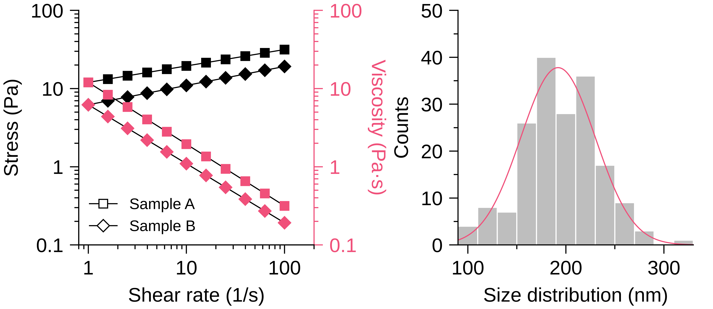
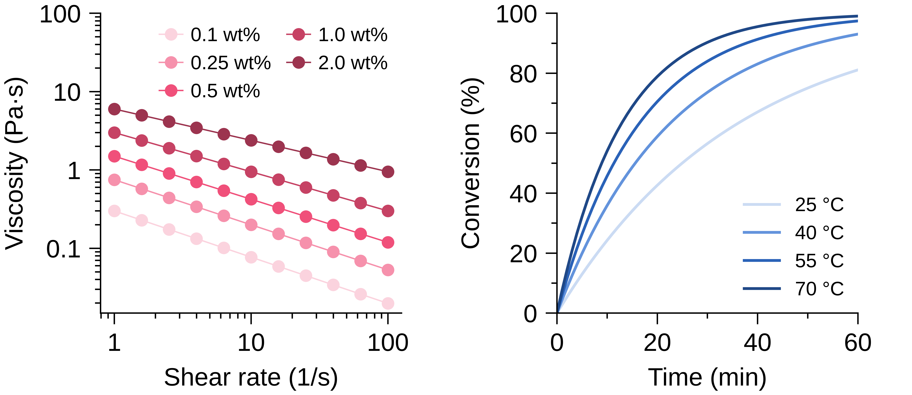

# data_rules

내 연구 작업에서 공통으로 쓰는 규칙 파일 모음이에요.

| 파일 | 하는 일 |
| --- | --- |
| `figstyle.py` | 논문 그림 스타일을 어디서나 똑같이 맞춰요 (Origin 느낌) |
| `devlog.py` | 작업 시작·끝에 git을 점검하고, 어느 컴퓨터에서 작업했는지 기록해요 |

## 설치

```bash
git clone https://github.com/yalmju/data_rules.git
pip install -r data_rules/requirements.txt
```

두 파일은 프로젝트 맨 위 폴더에 복사해서 쓰면 돼요.

## figstyle.py




```python
import figstyle as fs

fs.use()                        # 한글 라벨이 있으면 fs.use(korean=True)
fig, ax = fs.figure()           # 패널 여러 개: fs.figure(ncols=2)
ax.plot(x, y, "s-", label="sample")
fs.save(fig, "fig1")            # figures/fig1.pdf, .png, .svg
```

**규칙**
- Arial 18 pt (범례 14 pt, 테두리 없음)
- 축·눈금 굵기 1 pt, 바깥 눈금 8 pt (보조 4 pt), 주눈금 사이 보조눈금 1개
- 로그축: 2~9 위치에 보조눈금, 숫자는 0.1, 1, 10, 100으로 표시
- 데이터 선 1 pt, 마커 8 pt, 에러바 캡 4 pt
- 그림 높이 10 cm, 그래프 영역은 정사각형, 테두리는 L자
- 색 순서: 회색 → 핑크 → 초록 → 파랑 (`fs.GRAY`, `fs.PINK`, `fs.GREEN`, `fs.BLUE`)
- 시리즈 결과는 `fs.gradient(n, fs.PINK)`로 연한 색 → 진한 색

**자주 쓰는 기능**
- `fs.figure(box=True)`: 네 면 테두리
- `fs.figure(square=False, width_cm=16)`: 가로로 긴 그림
- `fs.twin_y(ax, color=fs.PINK)`: 오른쪽 축 (축선·눈금·글자 색을 맞춰 줌)
- `fs.save()`: 범례가 데이터와 겹치면 자동으로 옮김. 다른 위치 → 가로 배치 → 위쪽 여백 늘리기 → 그래프 밖 순서로 시도해요.

색이나 크기를 바꾸려면 `figstyle.py` 위쪽의 대문자 상수만 고치면 돼요.

## devlog.py

```bash
python devlog.py start   # 작업 시작
python devlog.py end     # 작업 끝: commit + push
python devlog.py log     # 최근 작업 기록
```

**start**
- 최신 코드를 받아요(pull). 이력이 갈라졌거나 저장 안 한 수정이 있으면 건드리지 않고 해결 방법만 알려줘요.
- 다른 컴퓨터에서 작업을 끝내지 않았으면 경고해요.
- `requirements.txt`에 있는데 이 컴퓨터에 안 깔린 패키지를 알려줘요.
- `.env`, `.venv/`, `__pycache__/`를 `.gitignore`에 자동으로 추가해요.

**end**
- commit하고, 그사이 다른 컴퓨터에서 올린 변경을 합친 뒤 push해요.
- 공개 저장소용 검사를 해요.
  - **올리지 않음:** API 키·토큰·비밀번호, `.env` 같은 비밀 파일, 50 MB 넘는 파일
  - **확인을 물음:** csv, xlsx, opju 같은 데이터 파일
  - **경고만:** `C:\Users\이름\...` 같은 내 컴퓨터 경로

작업 기록은 `.devlog/` 폴더에 컴퓨터별 파일로 따로 쌓여서, 여러 컴퓨터에서 써도 충돌하지 않아요. 실제 컴퓨터 이름 대신 별명을 쓰려면 환경변수 `DEVLOG_NAME`을 정해 두세요(예: `연구실PC`).
